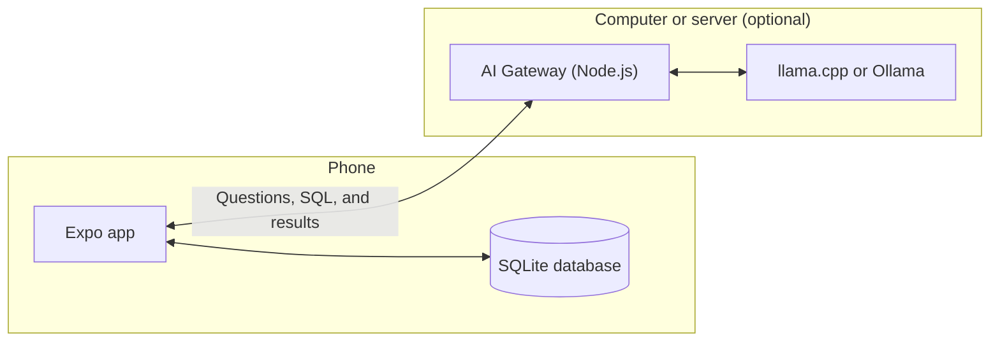
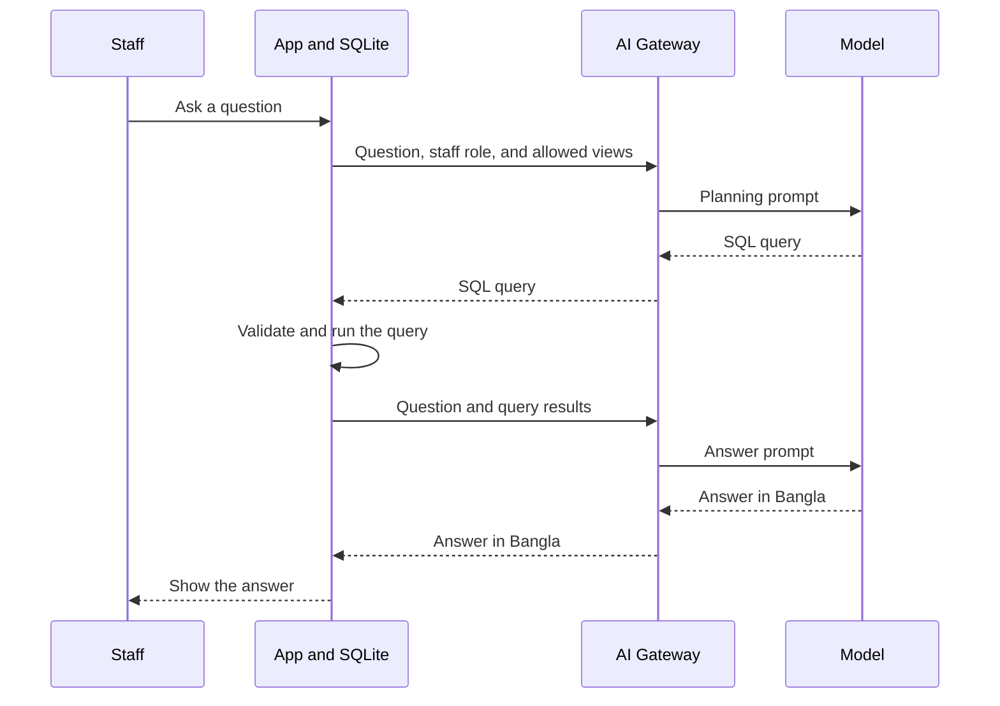

# Microfinance Field MVP

An offline-first mobile app that helps microfinance field teams collect repayments, track risk, and ask questions about their portfolio in everyday language.

Field officers use it to see who is due, record collections, and decide where to go first. Branch managers use it to monitor the branch and see which officers need support. Portfolio data is stored on the phone, so the core work continues without internet. An optional self-hosted AI model adds a chat assistant that answers in Bangla.

> **Demo project:** this MVP runs on generated demo data and is not ready for real customer data. See [Limitations](#limitations).

**Built with:** Expo SDK 54, React Native 0.81, TypeScript, SQLite (`expo-sqlite`), Node.js, and `llama.cpp` or Ollama.

## What it does

**Field officers (CDOs) can:**

- See today's VO meetings and their full list of assigned VOs
- Open any member to see their loans, repayment schedule, savings, DPS, and recent transactions
- Post loan installments, savings deposits, and DPS deposits, even when offline

**Branch managers (BMs) can:**

- See totals and loan risk for the whole branch
- Open any CDO, VO, or member to review their work (BM access is view only)

**Both roles get:**

- **AI insight cards:** daily priorities, such as who to follow up with and which VO to visit first
- **CDO ranking:** a performance score for each field officer in the branch
- **AI chat:** questions about the portfolio in Bangla, English, or Banglish

## Key terms

| Term | Meaning in this app |
| --- | --- |
| CDO | Field officer responsible for a set of VOs |
| BM | Branch Manager who supervises the CDOs |
| VO | Village Organization: a group of members with a regular meeting day and time |
| DPS | Deposit scheme with a monthly target and a maturity date |
| Current | Loan with no overdue installments |
| Late 1, Late 2 | Loan with 1 or 2 overdue installments |
| NIBL 1, NIBL 2 | Loan with 3 to 5, or 6 or more, overdue installments |

## How it works



The app reads and writes everything in the SQLite database on the phone. The AI Gateway is a small Node.js server that connects the app to a language model. It is only used for AI chat, so the rest of the app works without it.

### Daily workflow

1. **Log in:** staff sign in with a staff ID and PIN. On first launch, the app creates its database and fills it with demo data.
2. **Review the dashboard:** it shows members, VOs, due target, amount collected, overdue amount, savings, loans by status, and AI insight cards.
3. **Open a VO and a member:** the CDO sees what the member owes and their account history.
4. **Post a collection:** the CDO enters the loan, savings, and DPS amounts. Loan payments go to the oldest unpaid installments first, and partial payments are tracked.
5. **See the results:** balances, loan statuses, dashboards, insight cards, and rankings all update from the same local data.
6. **Supervise:** the BM reviews the branch and rankings, then opens any CDO who needs support.

### AI insight cards

Insight cards are created by rules on the phone, not by the language model, so they work offline.

- **CDOs see:** today's collection focus, the riskiest member, a suggested VO to start with, and a message when the target is reached.
- **BMs see:** the CDO who needs the most support, the branch's riskiest member, a portfolio summary, and the top performer.

Each card opens the related screen and can be marked **Complete**.

### CDO ranking

Each CDO gets a score out of 100, calculated on the phone.

| Part | Points | How it is measured |
| --- | --- | --- |
| Collection rate | 45 | Amount collected today compared with the amount due |
| Overdue amount | 25 | Full points with nothing overdue, and none at 250,000 or more |
| Risk | 20 | Based on overdue members and on loans at Late 2, NIBL 1, or NIBL 2 |
| Savings | 10 | Grows with member savings, up to full points at 250,000 |

### AI chat

The **Use Local AI** switch on the login screen controls how chat answers are made.

| | Use Local AI on (default) | Use Local AI off |
| --- | --- | --- |
| **How it answers** | The model writes the SQL query and the final answer | Uses the gateway when it can, otherwise local rules and Bangla templates |
| **Without a gateway or model** | Shows an error asking you to check the model server | Still answers from local data |

With **Use Local AI** on, a question goes through these steps:



The model never touches the database directly. The app checks each query before running it:

- It must be a single `SELECT` statement.
- It can only read the six `ai_*` reporting views, not the underlying tables.
- It must be limited to the staff member's own data: `cdo_id` for a CDO and `branch_id` for a BM.
- It returns at most 20 rows.

If a query fails these checks, the reason is sent back to the model for one more attempt.

Each chat message is labelled `online` or `offline`, so you can see where the answer came from.

Example questions:

| Language | Question | Meaning |
| --- | --- | --- |
| Bangla | `আজ কোথায় ফোকাস করব?` | Where should I focus today? |
| Bangla | `ঝুঁকিপূর্ণ সদস্য কারা?` | Which members are at risk? |
| Banglish | `Kar Kar collection ajke holo?` | Whose collections were done today? |

## Project structure

```text
App.tsx                  App screens and navigation
src/
  db.ts                  SQLite schema, demo data, portfolio queries, collection posting
  ai.ts                  Insight cards, CDO ranking, chat entry point, offline answers
  aiDynamic.ts           AI chat flow
  aiSqlEngine.ts         SQL planning requests and query validation
  aiQueryEngine.ts       Local rules that turn questions into queries
  aiConversation.ts      Chat intent detection
  aiDomain.ts            Savings and loan disbursement logic for chat answers
  network.ts             Finds the AI Gateway address
ai-server/
  server.js              AI Gateway
  config.example.json    Default model and runtime settings
  public/                Model configuration panel
```

## Getting started

### Requirements

- Node.js 22 and npm (tested with Node 22.17.0 and npm 11.4.2)
- A phone on the same Wi-Fi network as your computer
- Expo Go for SDK 54

This project uses Expo SDK 54. Expo Go from the app stores follows the latest SDK and may not open it. On Android, install the [SDK 54 build of Expo Go](https://expo.dev/go?sdkVersion=54&platform=android&device=true). On iPhone, check [expo.dev/go](https://expo.dev/go) for SDK 54 support.

### Run the app

Clone the repo, open a terminal in its folder, then run:

```bash
npm install
npm run start
```

Scan the QR code in the terminal with Expo Go.

The app seeds a local SQLite database on first launch. Use **Reset demo data** from the login screen when you want to recreate the dummy portfolio.

`npm run web` does not work yet because `react-dom` and `react-native-web` are not installed. Use a phone instead.

### Demo users

| Role | Staff ID | PIN |
| --- | --- | --- |
| Branch Manager | BM001 | 1234 |
| CDO | CDO101 | 1111 |
| CDO | CDO102 | 2222 |
| CDO | CDO103 | 3333 |

The demo data has 1 branch, 3 CDOs, 12 VOs, and 217 members, with generated loans, savings, and repayment history.

Turn off **Use Local AI** on the login screen if you have not connected a model.

### Start the AI Gateway (optional)

Start the gateway in a second terminal, on the same computer as Expo:

```bash
npm run ai:start
```

Open the model configuration panel on the same computer. It does not open from other devices:

```text
http://localhost:8787
```

The app finds the gateway automatically when it runs through Expo. For other builds, set `EXPO_PUBLIC_AI_GATEWAY_HOST` to the computer's address in a `.env` file.

The gateway can call either:

- `llama.cpp` OpenAI-compatible server at `http://localhost:8080`
- Ollama API at `http://localhost:11434`

For CPU MVP, use a small quantized GGUF model such as Qwen2.5 3B Instruct Q4 or Llama 3.2 3B Instruct Q4.

## Connect a model

The gateway keeps its settings in `ai-server/config.json`. It creates that file from `ai-server/config.example.json` on first start, and git ignores it, so your server address stays on your computer.

The default settings expect a model server at `http://localhost:8080`. Use one of the options below, then click **Health** in the panel to check the connection.

### Use an existing llama.cpp server

1. Set **Base URL** to the server's address.
2. Set **Model** to the model file name.
3. Click **Save Configuration**, then **Health**.

This project's own server uses `qwen2.5-7b-instruct-q8_0` from [Qwen/Qwen2.5-7B-Instruct-GGUF](https://huggingface.co/Qwen/Qwen2.5-7B-Instruct-GGUF/tree/main). To set it up, download all three parts and load `qwen2.5-7b-instruct-q8_0-00001-of-00003.gguf`.

### Run a model on this computer (Windows CPU)

1. Download `llama-b9072-bin-win-cpu-x64.zip` from the [llama.cpp b9072 release](https://github.com/ggml-org/llama.cpp/releases/tag/b9072) and extract it to `tools/llama-win-cpu/`.
2. Download `qwen2.5-3b-instruct-q4_k_m.gguf` (2.1 GB) from [Qwen/Qwen2.5-3B-Instruct-GGUF](https://huggingface.co/Qwen/Qwen2.5-3B-Instruct-GGUF/tree/main).
3. In the panel, choose the **llama.cpp CPU Safe** preset.
4. Set **Runtime executable** to the full path of `llama-server.exe`, and **Model** to the full path of the `.gguf` file.
5. Click **Save Configuration**, then **Start Runtime**, then **Health**.

## Limitations

- **Demo only:** do not use this app with real customer data.
- **No sync:** there is no central server, so each phone has its own database. A collection posted on a CDO's phone does not reach the BM's phone.
- **Basic login:** PINs are stored in plain text, and the demo accounts are shown on the login screen.
- **Data sent to the model:** when the gateway is reachable, questions, staff details, and query results are sent to it and to the model server. Results can include member names. The gateway also saves them to `ai-server/logs/ai-trace.log`.
- **Limited gateway security:** the configuration panel, settings, logs, and process controls only work on the computer running the gateway, and requests from websites are rejected. The chat routes the phone uses have no login, so any device on your network can use them to reach your model. Only run the gateway on a network you trust.
- **Phone only:** the web version does not work yet.

## Not in this repo

| Item | How to get it back |
| --- | --- |
| `node_modules/` | Run `npm install` |
| `llama.cpp` (`tools/`) | Download it as described in [Connect a model](#connect-a-model) |
| AI model files | Download them as described in [Connect a model](#connect-a-model) |
| `ai-server/config.json` | The gateway creates it from `ai-server/config.example.json` |
| `ai-server/logs/` | The gateway creates this folder when needed, but old logs are not restored |
| App data | Stored in SQLite on each phone. Demo data is recreated on first launch |
